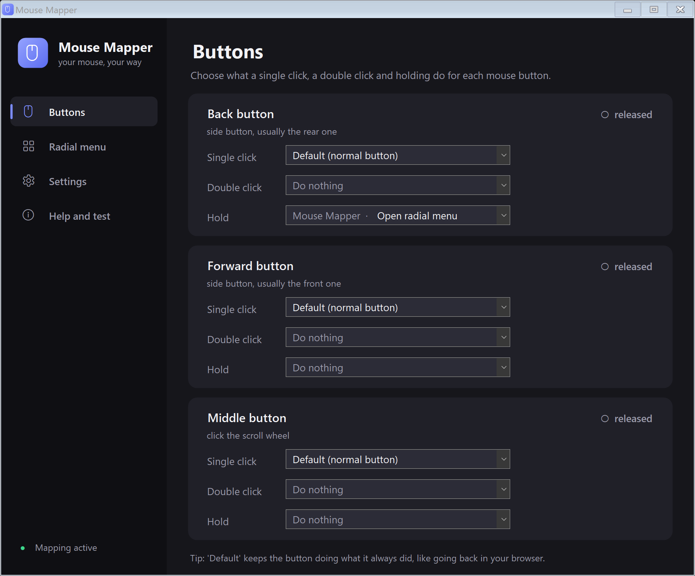
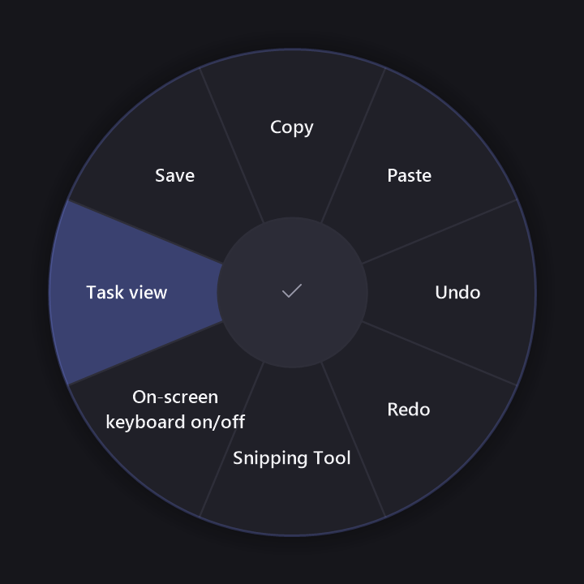

# Mouse Mapper

**Give the side buttons and middle button of any mouse your own functions.**
Single click, double click and hold — separately for each button. No manufacturer software needed.

🌐 **Website:** https://jillselten.github.io/mouse-mapper/



## Download

Get **`Mouse.Mapper.Setup.exe`** from the [latest release](../../releases/latest) and run it.
No administrator rights needed. Uninstall any time via *Windows Settings → Apps*.

> Windows may show a SmartScreen warning ("unknown publisher") because the app is not code-signed yet.
> Click **More info → Run anyway**.

## Features

- **Back, forward and middle button** — three actions each: single click, double click and hold
- **Default** — keep a button's normal function (e.g. browser back) and only add extra gestures
- **Radial menu** — hold a button and a round menu with 8 actions of your choice opens at your cursor
- **60+ actions**, custom shortcuts, typing text, opening programs or websites, quick menu
- **English and Dutch**, dark design, runs in the system tray, optional start with Windows



Works with almost any mouse with side buttons. Some gaming mice send their extra buttons as
keyboard keys; those are not detected (the *Help and test* page shows live what is seen).

## Building from source

Only Windows is needed (uses the C# compiler of .NET Framework 4.8):

```powershell
powershell -ExecutionPolicy Bypass -File build.ps1
```

| File | What it is |
| --- | --- |
| `MouseMapper.cs` | The app window, mouse hook and gestures |
| `Common.cs` | Shared parts: theme, settings, actions, controls |
| `Radial.cs` | The radial menu |
| `Setup.cs` | The installer |

Also by this maker: [Pen Mapper](https://github.com/JillSelten/pen-mapper) · [Pen Radial Menu](https://github.com/JillSelten/pen-radial-menu)

---

**Nederlands:** Mouse Mapper geeft de zijknoppen en de middelste knop van elke muis eigen functies:
één klik, dubbelklik en vasthouden, plus een radial menu. Download `Mouse.Mapper.Setup.exe` bij de
[nieuwste release](../../releases/latest).
